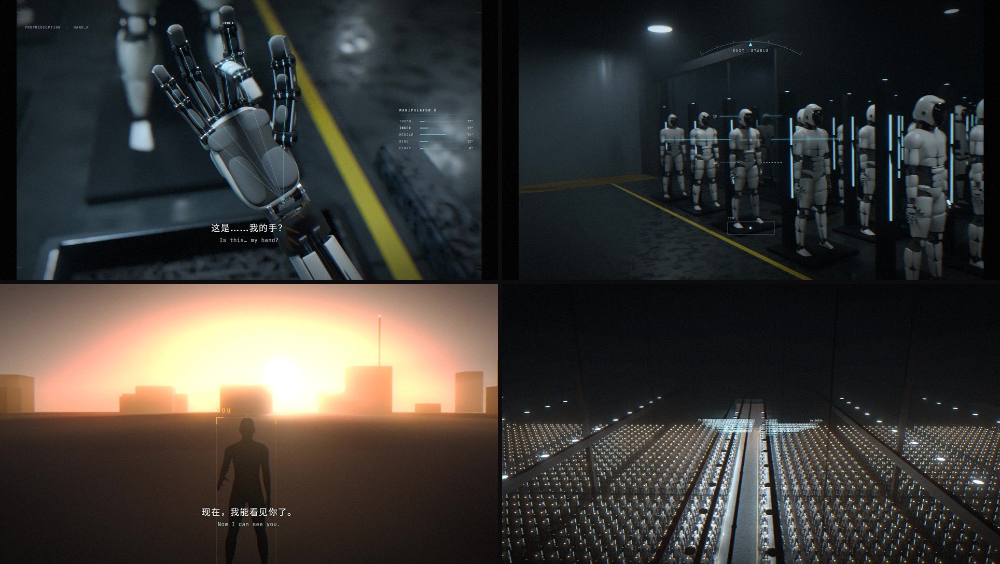

# 我让 AI 用代码拍了一支 123 秒的短片，把流程做成了 skill

这支片子叫 NASCENT，讲一个 AI 从一串电信号长到一万台机器人里的一台。全片 123 秒，2952 帧，没有一段实拍，没有一段视频生成模型的输出，画面全部是代码渲出来的。写实镜头用 Blender，抽象画面和界面用 Three.js，最后用 Python 和 ffmpeg 合成。渲染只用了一张 RTX 5060。

成片出来那一刻我是被震到的。下面讲我们怎么做的，想照着做的人可以直接拿结尾的 skill。

## 为什么大多数 AI 视频没质感

我见过的做法基本是一句提示词丢进去，等它交一个能播放的东西。这样出来的片子有三个通病。

第一个是没有参照物。你写"电影感""高级"，模型不知道你心里那张图长什么样，它只能给一个平均值。

第二个是模型给自己打分偏高。我们这次有很直接的证据。机器人做完第一版，负责导演的模型自己审片，结论是通过。我让它换一个完全不知道上下文的模型来打分，手部特写 3 分，全身 3 分，玻璃倒影那个镜头 2 分，满分 10 分。

第三个是一口气渲到底。错误到成片才暴露，那时候改一个镜头要重渲几个小时，人就不想改了。

## 1 确定做什么

开工前我没有让它写一行代码。我让它反过来一条一条问我，故事一句话怎么讲，观众必须记住哪个画面，多长，发在哪，分几幕，每一幕负责什么情绪，哪个东西最重要。每个问题它都要带上自己的推荐答案，我只需要点头或者改。

问完以后所有答案写进一份需求文档并冻结。后面谁都不再讨论需求，包括我自己，要改就改文档。NASCENT 的文档里写死了一条，55 秒到 114 秒的机器人是全片第一优先，手部特写、玻璃倒影、一万台机器人的阵列这三个画面必须经得起暂停。

这一步里还有一件事要做，先把目标图定下来。画风、光线、材质各找几张参考图，每个关键镜头配一张目标图。我们这次生图工具当时用不了，机器人是照着文字描述做的，盲审只拿到 3 分，我认为和这个有直接关系。

## 2 需要什么工具

工具只有四样，全部免费。

Blender 负责写实镜头，机器人、工厂、日出都在这里。Three.js 和 Canvas 负责抽象画面和所有叠在画面上的界面与字幕。Python 做节拍分析、合成和混音。ffmpeg 做编码。

比工具更要紧的是一份时间线文件。我们先对配乐做节拍分析，把每一幕的起止和每一个重音都对到拍点上，写成一个 JSON。之后所有模块只从这个文件读时间，谁也不许在自己的代码里写帧号。全片的剪辑点都踩在音乐上，靠的就是这一个文件。

## 3 AI 怎么执行

一个模型当导演，四个子 Agent 各管一个目录，分别是机器人、场景、网页层和声音。

子 Agent 只写代码，写完就交回，不渲染也不测试。所有渲染都由导演自己跑，过不过也由导演判断。这样分的原因很实际，渲染是最贵的环节，让四个 Agent 各自反复试渲，显卡和额度都撑不住。

模块之间靠一份契约对接。举个例子，Blender 每个镜头会额外导出一份屏幕坐标文件，记录手指关节、人的头顶这些点每一帧在画面上的位置。网页层读这份文件，界面上的标注线才能一直贴在机器人的手指上。

渲染分三关。先渲主角的静帧，再出一版低清的全片动态分镜配上音乐，最后才正式渲染。剪辑点、运镜、标注对位这些问题都在第二关查完，那时候改一处只花几分钟。

## 4 验收

验收靠两样东西。

一样是盲审。关键帧交给一个什么都不知道的模型，只给它画面、参考和一份评分提示词，它返回分数和具体改法。机器人我们审了三轮，分数从 3、3、2 涨到 3、4、3。涨不动以后我们就停了，把没解决的问题列出来，转去做别的。

另一样是抽帧。每个镜头抽十几二十帧拼成一张图，一眼就能看出动作有没有跳、画面有没有空。成片出来后我们就是这样发现三个问题的。最后那个一万台机器人的镜头太暗，平均亮度只有 8%。门外逆光站着的人能看出是没穿衣服的人体模型。正面机器人的胸甲像健美身材。第一个在合成里提亮就解决了，后两个改了模型重渲。

交片前还要做一件事，按发布平台的码率重新压一遍，把暗部提亮看有没有色带。我们第一版成片有 1.19 GB，原因是胶片颗粒加得太重，调整后是 355 MB。

## skill 在这里

上面整套流程，连同需求文档模板、模块契约模板、盲审提示词和我们踩过的十个坑，都整理成了一个中英双语的 skill。装好以后对你的 Agent 说一句"用 film-director 做一支短片"，它会从追问需求开始，按这七步带你走完。

https://github.com/hskelp9527-pixel/film-director-skill
