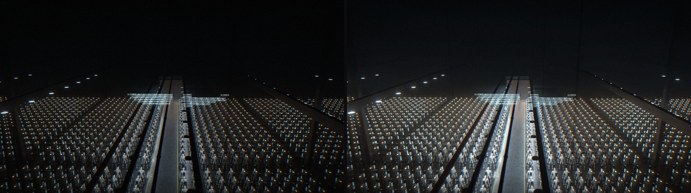
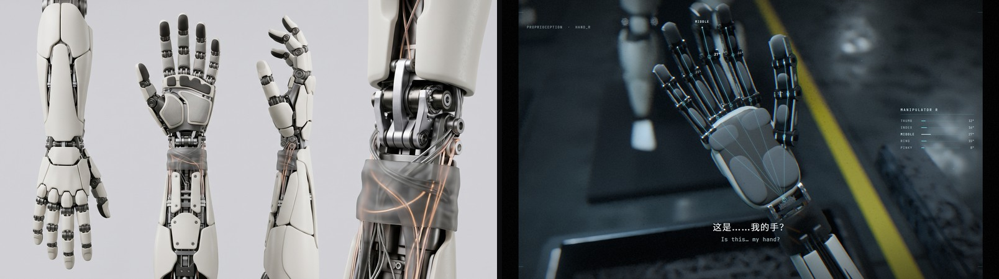
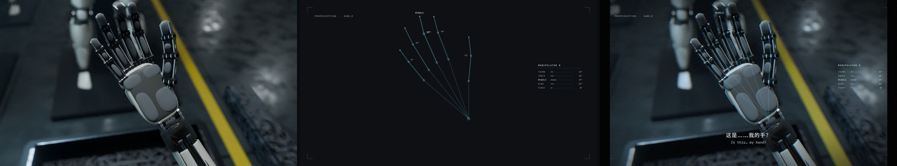
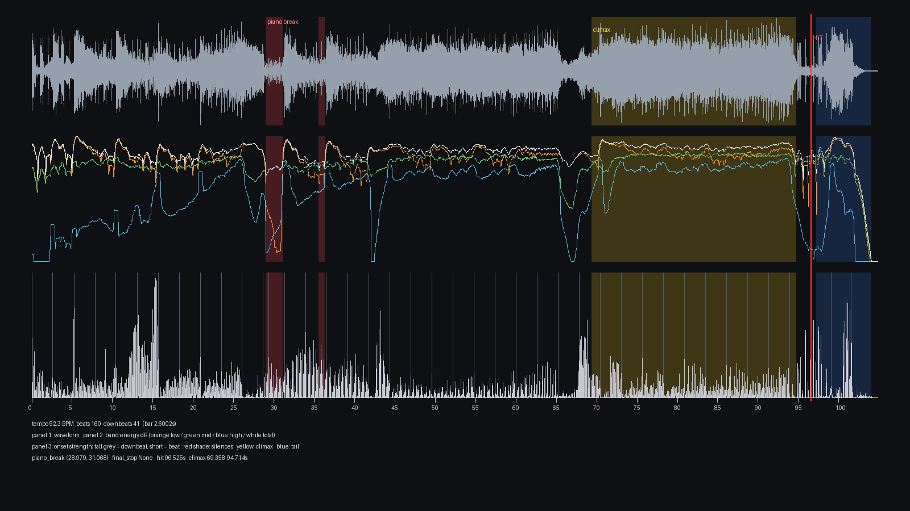
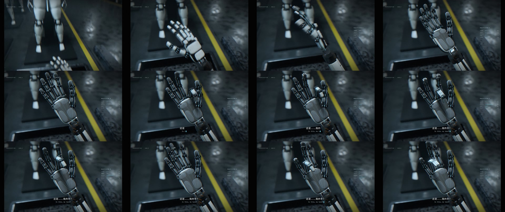
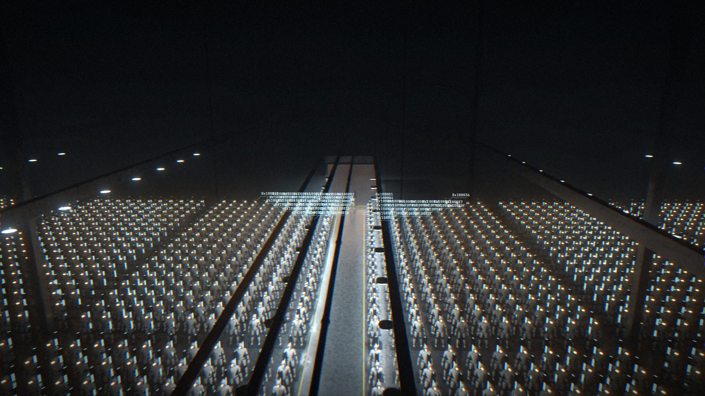

# NASCENT 发布帖（X 中文版）

## 钩子备选

**A 反差**

这支 123 秒的短片，没有一帧是拍的，也没有用任何视频生成模型。
全是 AI 写代码渲出来的。

**B 硬件**

一张 8G 显存的 RTX 5060，渲出了一支 123 秒的电影感短片。
没有实拍，没有视频模型，只有 AI 写的七千六百多行代码。

**C 打分**

AI 给自己做的片子打分，结论是通过。
换一个不知情的模型来审，手部特写 3 分，评语是这只手像玩具。
从那以后我知道大家的 AI 视频为什么没质感了。

## 主帖

【配成片视频 NASCENT】

这支 123 秒的短片，没有一帧是拍的，也没有用任何视频生成模型。
全是 AI 写代码渲出来的。

> 123 秒，2952 帧，九幕
> 7600 多行代码，全部由 AI 写
> 56 个音效，也是代码合成
> 一张 RTX 5060，8G 显存
> 1 个导演模型带 4 个子 Agent

第一次看完成片，我很震撼。
怎么做的，你怎么也能做，流程和 skill 都在下面 👇

## 串

### 2/8

先讲讲这支片子。

它叫 NASCENT，用 AI 自己的视角讲它怎么长大。
开头只有电信号。
后来它读懂了人类的照片和文字，在屏幕上回了一句 Not yet。
再后来它进了一台机器人的身体，抬起手看自己的手。
走到门口，看见日出和一个人。
最后镜头拉开，它身后站着一万台一模一样的机器人。

### 3/8

为什么大多数 AI 视频没质感？我踩过的坑集中在四处。

一，没有参照物。只写"高级""电影感"，AI 只能交一个平均水平的东西。
二，AI 给自己打分偏高。它说做好了，你就信了。
三，一口气做到底。错误最后才暴露，改一处要重渲很久，人就不想改了。
四，画面和音乐各走各的，剪辑点踩不上拍子，看着就松。

下面四步，每一步都对着这四条。

### 4/8

第 1 步，确定做什么。

开工前一行代码都不写。
让 AI 反过来追问我，一次一个问题，每个问题带着它推荐的答案，我点头或者改。
故事一句话怎么讲？观众必须记住哪个画面？多长，发哪，分几幕？哪个东西最重要？
问完写成一份需求文档，冻结，之后不再来回改。

我还准备了三张机器人参考图，建模和评审都对着它们来。

### 5/8

第 2 步，需要什么工具。

四样，全部免费。
Blender 做写实镜头，机器人、工厂、日出都在这里。
Three.js 做抽象画面，还有叠在上面的界面和字幕。
Python 做合成和混音，56 个音效也是它合成的。
ffmpeg 出最终视频。

显卡只用了一张 8G 显存的 RTX 5060。

下图是同一帧的三层，渲染的手、标注、合成后的成片画面。

### 6/8

第 3 步，AI 怎么执行。

一个模型当导演（Claude Fable），四个子 Agent（Opus）分别管机器人、场景、画面层、声音。
子 Agent 只写代码。渲染和好坏，都由导演判断。

配乐先定，所有剪辑点对在拍子上。

渲染分三关。
先渲主角静帧。
再出低清全片，这一版只花了 20 分钟。
前两关过了才正式渲，光机器人五个镜头就渲了五个半小时。

### 7/8

第 4 步，验收。这一步最容易被跳过。

导演模型自己审，结论是通过。
我把画面交给一个完全不知道上下文的模型，对着参考图打分。
手部特写 3 分，全身 3 分，玻璃倒影 2 分，满分 10。
评语说这只手像玩具，手指像乐高积木。
改了三轮，到 3、4、3 停下，把没解决的问题列清楚。

成片后再抽帧，又找出四个问题。
一万台机器人太暗，门外的人看得出是人体模型，胸甲像健美身材，有五秒只有一面灰墙。
全部改掉了。

### 8/8

这套流程我做成了一个 skill，叫 film-director，中英双语。
七个阶段的流程、需求文档模板、分工模板、盲审提示词，还有十个我们实际踩过的坑，都在里面。

怎么用？
把仓库里的 skills/film-director 目录复制到你的 Agent 的 skill 目录。
然后说一句"用 film-director 做一支短片"。
它会从追问需求开始，一步步带你走完。
电脑上装好 Blender、Node.js、Python、ffmpeg 就行。

https://github.com/hskelp9527-pixel/film-director-skill

有用的话收藏转发，做出来的片子发我看看。

## 长文版

# 没拍一帧，没用视频模型，我和 AI 用代码做了一支 123 秒的短片

【配成片视频 NASCENT】

这支片子叫 NASCENT，用 AI 自己的视角讲它怎么长大。

开头只有电信号。后来它读懂了人类的照片和文字，在屏幕上回了一句 Not yet。再后来它进了一台机器人的身体，抬起手看自己的手，走到门口，看见日出和一个人。最后镜头拉开，它身后站着一万台一模一样的机器人。

全片 123 秒，九幕，2952 帧。没有实拍，没有用任何视频生成模型，画面全是代码渲出来的。代码七千六百多行，全部是 AI 写的。56 个音效也是代码合成的。渲染只用了一张 RTX 5060，8G 显存。

第一次看完成片，我很震撼。下面把怎么做的讲清楚，最后给一个 skill，装上就能照着这套流程做。

### 为什么大家做的 AI 视频没质感

我自己踩过，原因集中在四处。

没有参照物。提示词里写"高级""电影感"，AI 不知道你脑子里那张图长什么样，只能交一个平均水平的东西。

AI 给自己打分偏高。它说做好了，人就信了，问题一路留到成片里。

一口气做到底。错误到最后才暴露，那时候改一处要重渲很久，人就不想改了，片子停在六十分。

画面和音乐各走各的。剪辑点踩不上拍子，看着就松。

下面四步，每一步都对着这四条。

### 1 确定做什么

开工前，我没让 AI 写一行代码，先让它反过来追问我。一次只问一个问题，每个问题都带着它推荐的答案，我点头或者改。

它问的是这些。故事用一句话怎么讲。观众看完必须记住哪一个画面。片子多长，发在哪个平台。分几幕，每一幕负责什么。哪个东西最重要，时间优先花在谁身上。

问完，它把答案写成一份需求文档，然后冻结。之后不再来回讨论需求，大家照着文档做。

我还准备了三张机器人参考图，全身、手、头和上身。建模对着它们做，后面的评审也对着它们打分。有了参考图，想要的质感就有了一张可以直接比对的图。

### 2 需要什么工具

一共四样，全部免费。

Blender 负责写实镜头，机器人、工厂、卷帘门、日出都在这里做。Three.js 负责抽象画面，还有叠在画面上的界面和字幕。Python 负责合成和混音，56 个音效也是用它合成的。ffmpeg 负责出最终的视频文件。

两套画面各做各擅长的。Blender 的光和材质真实，网页画出来的文字和标注又快又清楚。最后叠在一起，就是成片里的一帧。

机器也不用多好。整部片子只在一张 8G 显存的 RTX 5060 上渲完。

### 3 AI 怎么执行

一个模型当导演，我用的是 Claude Fable。四个子 Agent 用 Opus，分别负责机器人、场景、网页画面层和声音。

分工有一条硬规矩。子 Agent 只写代码，写完就交回。渲染和好不好的判断，全部由导演来做。渲染是整个流程里最费时间的环节，集中在导演手里，四个 Agent 就不会抢同一张显卡。

配乐是最先定的。定下来以后分析节拍，每一幕的起止、每一个重音，都对在音乐的拍点上。卷帘门升起、阳光冲进来的那一刻，正好踩在一个重音上。

渲染分三关。第一关只渲主角静帧，看机器人的造型和材质。第二关出一版低清全片，配上音乐，这一版只花了 20 分钟，剪辑点和运镜都在这时候查，改起来很快。第三关才正式渲染，光机器人的五个镜头就渲了五个半小时。越往后改代价越大，所以问题要尽量在前两关解决。

### 4 验收

这一步最容易被跳过，也最要紧。

机器人第一版做完，导演模型自己审片，结论是通过。我让它把画面交给一个完全不知道上下文的模型，只给参考图和渲染图，让它对着打分，再说出具体怎么改。

结果是手部特写 3 分，全身 3 分，玻璃倒影 2 分，满分 10 分。评语说这只手像玩具，手指像乐高积木。

照着意见改了三轮，分数到了 3、4、3。再往上涨不动，我们就停下来，把没解决的问题一条条列清楚。用代码建模去追参考图的精度，现在确实还有差距，这一点我不想瞒着。

成片出来以后，还要抽帧检查，把画面一张张排开看。这样又找出四个问题。一万台机器人的镜头太暗。门外逆光的人能看出是人体模型。正面那台机器人的胸甲像健美身材。走到卷帘门前有五秒，画面里只有一面灰墙。四个问题都改掉了。

### 装上 skill，照着流程做

这套流程我整理成了一个 skill，叫 film-director，中英双语。里面有七个阶段的流程、需求文档模板、分工模板、盲审提示词，还有十个我们实际踩过的坑。

用法很简单。把仓库里的 skills/film-director 目录复制到你的 Agent 的 skill 目录，然后对它说一句"用 film-director 做一支短片"。它会从追问需求开始，一步步带你走完上面四步。电脑上装好 Blender、Node.js、Python 和 ffmpeg 就行。

https://github.com/hskelp9527-pixel/film-director-skill

有用的话收藏转发。做出来的片子，欢迎发给我看。
